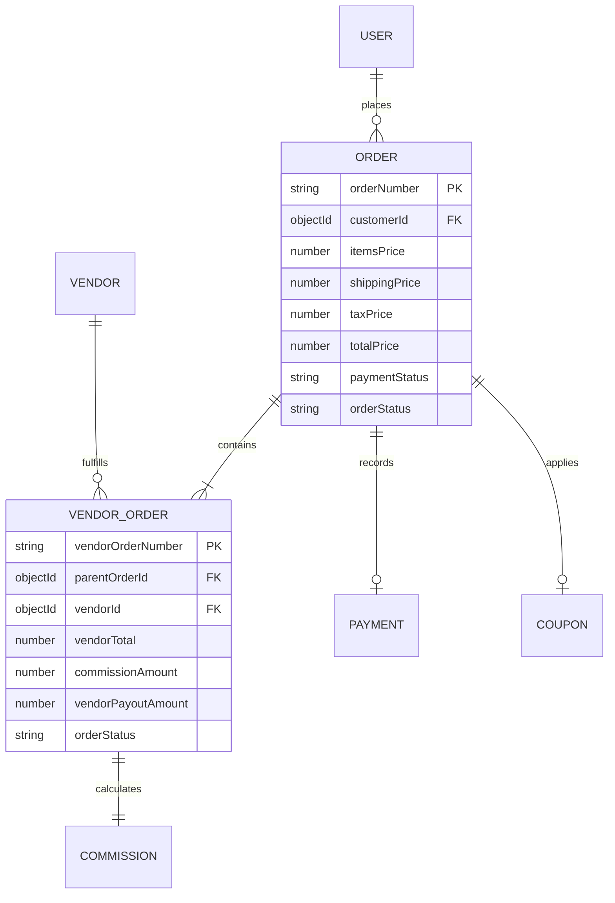

# MarketSphere Database & Data Architecture Specification

## 1. Storage & Database Overview

MarketSphere uses MongoDB (Mongoose ODM) with 12 interconnected schemas tailored for Indian multi-vendor retail:
- **`User`**: Account identities, credentials, Specification Roles (`customer`, `vendor`, `admin`), active status, refresh token.
- **`Vendor`**: GST-registered vendor store profile, PAN, Indian bank details (IFSC), commission rate, ratings.
- **`Address`**: Dedicated customer delivery addresses with Indian PIN codes and 10-digit mobile numbers.
- **`Category`**: Hierarchical category taxonomy with automatic slug generation.
- **`Product`**: Product catalog items with SKU, INR pricing, stock, attributes, and text search indexes.
- **`Order`**: Parent order encapsulating checkout session, totals, shipping address, and coupon deductions.
- **`VendorOrder`**: Suborders partitioned per vendor containing vendor items, commission cut, and tracking.
- **`Payment`**: Razorpay gateway transactions, order references, HMAC signatures, and refund status.
- **`Coupon`**: Promotional discount codes (percentage/fixed) with validity windows and minimum spend limits.
- **`Commission`**: Platform accounting records calculating take rate, 18% GST, and net vendor payout.
- **`Notification`**: In-app notifications for order milestones and payment confirmations.
- **`Review`**: Customer reviews restricted to 1 review per product per customer, automatically updating product rating averages.

---

## 2. Schema Specifications

### 2.1 Users Collection (`users`)
| Field | Type | Constraints / Description |
| :--- | :--- | :--- |
| `_id` | ObjectId | Primary Key |
| `name` | String | Required, trimmed, max 100 chars |
| `email` | String | Unique, lowercase, indexed |
| `password` | String | Bcrypt hash, select: false |
| `role` | String | Enum: `['customer', 'vendor', 'admin']`, default: `'customer'` |
| `phone` | String | 10-digit mobile number |
| `vendorId` | ObjectId | References `vendors._id` (if vendor) |
| `wishlist` | [ObjectId]| References `products._id` |
| `refreshToken`| String | Hashed active refresh token |
| `isActive` | Boolean | Default: `true` |

---

### 2.2 Vendors Collection (`vendors`)
| Field | Type | Constraints / Description |
| :--- | :--- | :--- |
| `_id` | ObjectId | Primary Key |
| `userId` | ObjectId | Unique, references `users._id` |
| `businessName`| String | Required, max 120 chars |
| `storeSlug` | String | Unique, indexed, URL-friendly |
| `gstin` | String | 15-character Indian GST Identification Number |
| `pan` | String | 10-character Indian Permanent Account Number |
| `bankDetails` | Object | Account holder, Account number, IFSC code, Bank name |
| `address` | Object | Street, City, State, 6-digit PIN code |
| `commissionRate`| Number | Platform commission percentage (default: 10%) |
| `rating` | Number | 0 to 5 scale |
| `isVerified` | Boolean | Admin verification toggle |
| `status` | String | Enum: `['pending', 'approved', 'suspended', 'rejected']` |

---

### 2.3 Orders & Suborders Collections (`orders`, `vendororders`)

